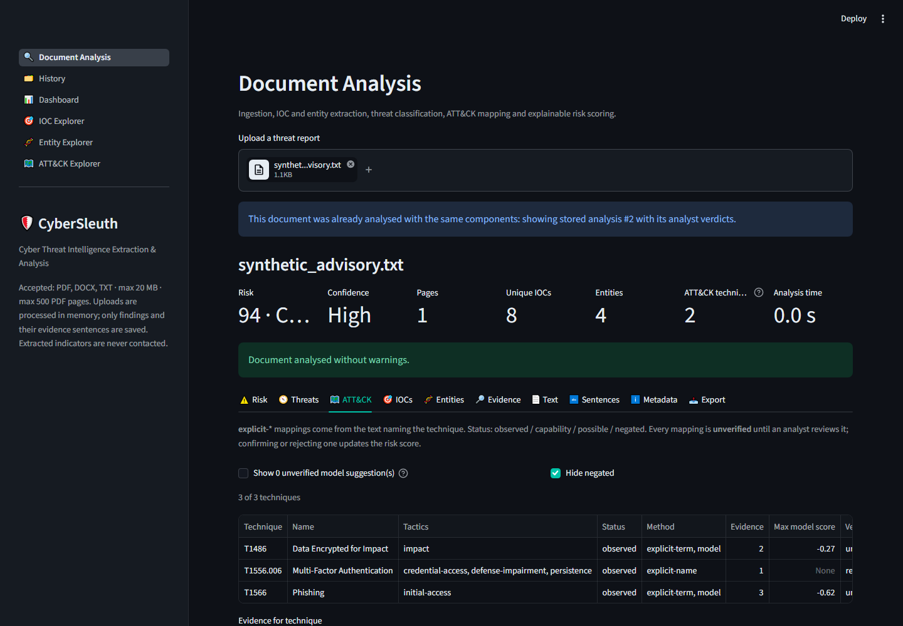

# CyberSleuth

**AI-Powered Cyber Threat Intelligence Extraction and Analysis Platform**

CyberSleuth turns unstructured cybersecurity reports (PDF, DOCX, TXT) into
structured, explainable, evidence-backed threat intelligence. It runs entirely
locally with free and open-source tools and needs no paid API.

> **Status: Phase 5 work complete; release v1.0.0 pending.** Everything below works and is
> tested:
> * ingestion, IOC extraction and entity recognition;
> * threat classification and MITRE ATT&CK mapping;
> * explainable risk scoring;
> * analyst verification, a dashboard with cross-document explorers, and reports;
> * evaluation on 31 real CISA advisories, a security review, performance hardening and
>   deployment files.
>
> Still to do: publishing the model release and the final tag. See the [Roadmap](#roadmap).



More screenshots: [risk](docs/screenshots/analysis_risk.png) ·
[indicators](docs/screenshots/analysis_iocs.png) · [dashboard](docs/screenshots/dashboard.png) ·
[history](docs/screenshots/history.png) · [IOC explorer](docs/screenshots/ioc_explorer.png) ·
[ATT&CK explorer](docs/screenshots/attack_explorer.png). All of them show synthetic sample
data only (`python scripts/take_screenshots.py`). The [demo guide](docs/demo.md) walks
through them.

## Problem

Threat intelligence arrives as long, unstructured advisories and vendor reports.
Analysts pull out indicators, actors and techniques by hand, which is slow,
inconsistent and hard to audit. CyberSleuth automates the extraction and keeps
an evidence trail for every finding: document, page and character position.

## Features (implemented)

* **Safe document ingestion**
  * File type detected from the content, so the extension isn't trusted.
  * Limits on file size and PDF pages.
  * Protection against DOCX zip bombs.
  * Encrypted PDFs rejected.
* **Text extraction**
  * PDF page by page, with document metadata.
  * DOCX paragraphs and tables in document order.
  * TXT with automatic encoding detection.
* **Clear handling of hard documents**
  * Scanned PDF pages flagged as needing OCR.
  * Damaged PDFs repaired with a warning.
  * Undecodable bytes reported.
* **Text cleaning that leaves indicators unchanged**: Unicode normalisation that
  keeps `hxxp://`, `evil[.]com`, `10[.]0[.]0[.]5`, hashes and CVE IDs exactly as written.
* **Sentence segmentation with exact source positions**, the base for
  evidence-backed findings.
* **IOC extraction** of IPv4, domains, URLs, emails, MD5/SHA-1/SHA-256 and CVE IDs.
  * Handles defanged forms (`hxxp`, `[.]`, `[at]`).
  * Validated against an IANA TLD snapshot and Python's IP parser.
  * Guards against filenames, version strings and .NET namespaces.
  * De-duplicated, with page, position and sentence for every occurrence.
  * Flags such as private IP or documentation range. Indicators are **never** treated
    as malicious by default.
* **Cybersecurity entity recognition** of malware, threat actors, tools, named
  vulnerabilities, attack techniques, organisations and locations.
  * Uses a MITRE ATT&CK v20.1 knowledge base with aliases (`Fancy Bear` → APT28, G0007),
    curated lists, actor naming patterns and spaCy.
  * Resolves ambiguous names from context (`Cuba` ransomware vs. the country).
  * Records the source of every entity, and invents no confidence scores.
* **Threat classification**: report categories from a TF-IDF + Logistic Regression model
  (trained on Hugging Face ATT&CK procedure data) plus a keyword rule baseline, with evidence
  sentences and negation handling.
* **MITRE ATT&CK mapping** (v20.1): explicit matches (IDs, technique names, curated terms) and
  model suggestions, each with an assertion status (observed / capability / possible /
  negated). Every mapping starts unverified.
  * Model-only suggestions are **unverified leads**: hidden by default, listed separately in
    reports, and excluded from the risk score until an analyst confirms them. Confirming or
    rejecting a technique re-scores the analysis.
* **Explainable risk score**: R = 0.30V + 0.25M + 0.25A + 0.20E, with a reasoned breakdown for
  each component. It uses the CISA KEV catalogue, guards against inflation and double
  counting, and reports a separate confidence level ([methodology](docs/methodology.md#10-risk-scoring-phase-3)).
* **Persistence and analyst verification**: SQLite + SQLAlchemy store every analysis.
  * Documents are de-duplicated by SHA-256, and re-analyses are kept as history.
  * Analysts can mark IOCs (malicious / benign / false positive) and ATT&CK mappings
    (confirmed / rejected) with notes. Every change goes into an append-only audit log.
  * Only findings and their evidence sentences are stored; the full text is opt-in.
* **Dashboard and cross-document explorers** (Plotly):
  * Charts of risk bands, threat categories, ATT&CK tactics and IOC types.
  * An **IOC Explorer** showing which reports share an indicator, an **Entity Explorer**, and an
    **ATT&CK Explorer** with verification coverage and a tactic × document heatmap.
  * Counts use documents, not mentions, and only the latest analysis per document.
* **Reports** ([docs/reports.md](docs/reports.md)):
  * **PDF** for analysts, **JSON** (complete, versioned schema) and **CSV** tables (ZIP).
  * They include evidence sentences, analyst verdicts and notes, the verification history and
    the limitations.
  * Indicators and evidence are defanged, CSV formula injection is neutralised, and the full
    document text is never exported.
* **Evidence views**: findings for each sentence, and CVE IDs merged with named
  vulnerabilities (Log4Shell ↔ CVE-2021-44228).
* **Streamlit interface**: IOC, Entity and Evidence explorers with filters and search,
  and ATT&CK/NVD reference links. Document text, sentence and metadata views.

## Evaluation

### Real-world test: 14 CISA advisories (scored once)
Gold labels come from CISA itself: the ATT&CK IDs each advisory cites, and its STIX indicator
bundle ([results](docs/evaluation/real_world.md), [error analysis](docs/evaluation/real_world_analysis.md)):

| Component | Result on real advisories |
|---|---|
| IPv4 extraction | 654 of 657 STIX IPs found; 99% of extracted IPs are in STIX |
| Hash extraction | 100% of the hashes printed in the PDFs found |
| Technique matching (IDs masked, name/term matcher) | precision 0.70, recall 0.56 (parent technique) |
| **Model-only technique suggestions** | **only 10% agree with CISA** (85% of suggestions have a low score; those agree 3% of the time) |

The technique model doesn't transfer from ATT&CK procedure text to real reports at its current
threshold. Model suggestions are therefore treated as unverified leads (hidden by default and
excluded from the risk score until confirmed).

### Real-world follow-up: a cut-off for model suggestions, tested on 8 new advisories
A second set of 17 CISA advisories (2022–2025) was split once into development (9) and test
(8).
* **Choosing the cut-off:** a rule fixed in advance chose a decision-score cut-off of **0.75**
  for model-only suggestions on the development split
  ([selection](docs/evaluation/real_world_threshold.md)).
* **Testing it:** the test split was then scored once with the code frozen
  ([results](docs/evaluation/real_world_batch2_test.md)).

| Model-only suggestions (test split) | Suggestions | Agree with CISA (parent) |
|---|---|---|
| Without the cut-off | 281 | 0.10 |
| **With the 0.75 cut-off** | **15** | **0.80** (95% interval 0.55–0.93) |

* **What changed:** the cut-off turns model suggestions from noise into usable leads.
* **The cost is coverage:** about 2 suggestions per advisory remain. With IDs masked, the
  model alone recovers 12% of CISA's techniques (parent level). The name/term matcher still
  does most of the work.
* **Uncertainty:** 15 suggestions is a small sample, and the interval treats them as
  independent.
* **Unchanged:** suggestions stay unverified leads until an analyst confirms them.

### Synthetic extraction test set
8 synthetic, author-annotated documents, split dev/test. The test split was scored once,
with the code frozen ([details and every error](docs/evaluation/README.md)):

| Test split | Precision | Recall | F1 |
|---|---:|---:|---:|
| IOC extraction | 1.00 | 1.00 | 1.00 |
| Entity recognition (rules + spaCy) | 0.87 | 0.83 | 0.85 |
| Entity recognition (rules only) | 1.00 | 0.55 | 0.71 |

This is a small, self-made set. The numbers are **not** a real-world accuracy claim.

### Threat-category classifier
TF-IDF + Logistic Regression, trained on 10,313 ATT&CK procedure sentences from the Hugging
Face dataset [`sarahwei/cyber_MITRE_technique_CTI_dataset_v16`](https://huggingface.co/datasets/sarahwei/cyber_MITRE_technique_CTI_dataset_v16).
Category labels are derived from technique labels. Results are on a test split of
**unseen actors**, scored once ([model card](docs/models/threat_classifier.md)):

| Test split (2,149 sentences) | Macro F1 (95% CI) |
|---|---|
| TF-IDF + Logistic Regression | **0.83** (0.73–0.88) |
| Rule baseline | 0.64 (0.59–0.69) |
| Majority baseline | 0.00 |

### ATT&CK technique mapping
Explicit matching (technique IDs, ATT&CK names, curated terms) plus a LinearSVC suggesting one
of 196 parent techniques. Each mapping gets an assertion status (observed / capability /
possible / negated) and starts unverified ([model card](docs/models/technique_mapper.md)):

| Test split (2,149 sentences, unseen actors) | Value (95% CI) |
|---|---|
| Model top-1 / top-5 accuracy | **0.82** (0.80–0.83) / 0.95 |
| Explicit matcher precision (lower bound) | 0.63 |

Sentence-level results on ATT&CK-style text. Expect lower performance on real reports.

## Architecture

```text
Upload → Validation → Extraction → Cleaning → Sentences → IOCs & Entities → Evidence
       → Threat Classification → MITRE ATT&CK → Risk Scoring → Database → Dashboard / Reports
```

Details: [docs/architecture.md](docs/architecture.md) · Methodology and
limitations: [docs/methodology.md](docs/methodology.md)

## Technology stack

| Area | Tools |
|---|---|
| Language | Python 3.12 |
| UI | Streamlit (multipage), Plotly |
| Documents | PyMuPDF, python-docx |
| Data | pandas, SQLite + SQLAlchemy 2.0 |
| NLP / ML | spaCy 3.8 (`en_core_web_sm`), regex extraction, MITRE ATT&CK v20.1 KB, scikit-learn (TF-IDF, Logistic Regression, LinearSVC) |
| Reports | fpdf2 (PDF), json, csv |
| Quality | pytest, pytest-cov, ruff |

## Installation (Windows)

```powershell
git clone https://github.com/zainmatloob-cyber/CYBERSLEUTH.git
cd CYBERSLEUTH
py -3.12 -m venv .venv
.\.venv\Scripts\Activate.ps1   # if blocked: Set-ExecutionPolicy -Scope CurrentUser RemoteSigned
python -m pip install --upgrade pip
pip install -r requirements-dev.txt
```

On macOS/Linux, use `python3.12 -m venv .venv` and `source .venv/bin/activate`.
`requirements.lock.txt` pins the exact versions the tests last passed with.

## Get the trained models

The model files are git-ignored. Download the exact files every recorded result was measured
with; each is checked against a SHA-256 pinned in `config/model_files.json`:

```powershell
python scripts/fetch_models.py            # from the GitHub release "models-v1"
python scripts/fetch_models.py --verify   # check local files, no download
```

To retrain instead (about 2 minutes), run the commands below. The new files won't be
byte-identical to the evaluated ones. `--final` also re-scores the held-out test splits, so
use it only for a deliberate retrain:

```powershell
python scripts/prepare_threat_dataset.py   # downloads the pinned Hugging Face dataset, verifies SHA-256
python scripts/train_threat_classifier.py --final
python scripts/train_technique_model.py --final
```

Without the models the app still runs. Threat categories then come from rules only, ATT&CK mapping
from explicit matches only, and the analysis shows a warning and lowers its confidence.

## Usage

On Windows, run `start.cmd`. On first launch it creates a Python 3.12 virtual environment
and installs the runtime dependencies.

Or start the app from an activated environment with:

```powershell
streamlit run app.py
```

Open http://localhost:8501 and upload a report. Synthetic demo documents are in
[`data/samples/`](data/samples/); regenerate them with `python scripts/make_samples.py`.

**New web interface (in progress).** A FastAPI + HTMX interface with light and dark themes is replacing
Streamlit. Try it with `python -m src.web` and open http://127.0.0.1:8000. It currently covers
upload, the summary and the Risk, Threats, Entities, Evidence, Text, Sentences and Metadata tabs.

Programmatic use:

```python
from src.intelligence.analyzer import Analyzer

result = Analyzer().analyze(open("report.pdf", "rb").read(), "report.pdf")
for indicator in result.indicators:
    print(indicator.ioc_type, indicator.value, indicator.count, sorted(indicator.flags))
for entity in result.entities:
    print(entity.entity_type, entity.name, entity.kb_id, entity.source)
```

Evaluate extraction quality: `python scripts/evaluate_extraction.py --split dev`.

### Docker and other deployments

```bash
docker build -t cybersleuth .
docker run --rm -p 8501:8501 --memory 1g -v cybersleuth-db:/var/lib/cybersleuth cybersleuth
```

The image runs as a non-root user, downloads and verifies the models during the build, and
keeps the database in a volume.

> **The Dockerfile hasn't been built yet:** Docker wasn't available on the development
> machine. Its start command, health check and structure were checked without Docker.

[docs/deployment.md](docs/deployment.md) covers local, Docker and Streamlit Community Cloud
deployment. The app has **no login**, so read the deployment limits in
[docs/security.md](docs/security.md) before sharing it.

## Configuration

Limits are defined in [`config/settings.py`](config/settings.py); see
[docs/security.md](docs/security.md) for the security review and the reasons for each limit.
Override them with environment variables:

| Variable | Default |
|---|---|
| `CYBERSLEUTH_MAX_FILE_SIZE_MB` | 20 |
| `CYBERSLEUTH_MAX_PDF_PAGES` | 500 |
| `CYBERSLEUTH_MAX_DOCX_UNCOMPRESSED_MB` | 100 |
| `CYBERSLEUTH_MAX_DOCX_ZIP_ENTRIES` | 2000 |
| `CYBERSLEUTH_MAX_TEXT_CHARS` | 1000000 (extracted text, all formats) |
| `CYBERSLEUTH_MIN_CHARS_PER_TEXT_PAGE` | 20 |
| `CYBERSLEUTH_LOG_LEVEL` | INFO |
| `CYBERSLEUTH_SPACY_MODEL` | en_core_web_sm |
| `CYBERSLEUTH_SPACY_BATCH_SIZE` | 64 |
| `CYBERSLEUTH_DB_URL` | `sqlite:///data/cybersleuth.db` |
| `CYBERSLEUTH_STORE_FULL_TEXT` | 0 (store evidence sentences only) |
| `CYBERSLEUTH_ANALYST` | analyst (name recorded in the audit log) |

## Testing

```powershell
pytest                                          # full suite
pytest --cov=src --cov=app --cov-report=term-missing
ruff check .
```

570 tests; line coverage of `src/` is 98% (2026-11-08). The uncovered lines are mostly
minor UI branches and defensive checks a test can't reach, such as a zero-page PDF, which
PyMuPDF can't create.

The suite covers:
* validation and attack cases (disguised executables, zip bombs, path traversal,
  Markdown injection);
* model and knowledge-base files: wrong object type, wrong format version, other
  scikit-learn version, corrupt JSON;
* the upload flow: a rerun doesn't re-analyse, a duplicate document reopens the stored
  analysis, a failed save still shows the result, errors are escaped, and unexpected
  failures show a generic message with the details only in the log;
* every reader's edge cases;
* cleaning that leaves IOCs intact, and the sentence-position invariant;
* IOC false-positive traps and defanging variants;
* entity disambiguation and knowledge-base integrity;
* the evaluation metrics;
* persistence, hydration round-trips and the verification audit trail;
* dashboard aggregations (document counting, negation, re-analysis);
* report safety (defanging, formula injection, no full text, link restrictions);
* end-to-end analysis, and the UI through Streamlit's `AppTest`.

Model-dependent tests are skipped automatically if `en_core_web_sm` is not installed.

## Project structure

```text
app.py                  Streamlit entry point
config/settings.py      Limits and paths (environment overrides)
src/ingestion/          Validation, readers, cleaning, pipeline, data models
src/nlp/                Sentence segmentation, IOC extraction, entity recognition, KB loader
src/intelligence/       Analysis orchestrator, ATT&CK mapping, threat assessment, risk, evidence
src/evaluation/         Precision/recall/F1 and the gold-file evaluation runner
src/ml/                 Threat-category dataset, rule baseline, classifier, evaluation
src/visualization/      Table builders, cross-document aggregations, Plotly figures
src/ui/                 Streamlit pages (Analysis, History, Dashboard, IOC/Entity/ATT&CK explorers)
src/database/           SQLAlchemy schema, repository, hydration of stored analyses
src/reporting/          PDF/JSON/CSV report exports
data/knowledge_base/    Versioned IANA TLDs, ATT&CK-derived entities, curated lists, rules
data/evaluation/        Annotation guidelines and the annotated dev/test documents
scripts/                Sample generator, ATT&CK KB builder, evaluation runner
tests/                  pytest suite
docs/                   Architecture, methodology, evaluation, security, performance,
                        deployment and demo guides; screenshots
Dockerfile              Container image (see docs/deployment.md)
```

## Roadmap

- [x] **Phase 1:** Foundation and document ingestion
- [x] **Phase 2:** IOC extraction, cybersecurity named-entity recognition, evidence views, evaluation
- [x] **Phase 3:** Threat classification (rule baseline + TF-IDF/Logistic Regression), MITRE ATT&CK mapping, explainable risk scoring
- [x] **Phase 4:** SQLite persistence and analyst verification, dashboard, explorers, PDF/JSON/CSV reports
- [x] **Phase 5:**
  * evaluation on 31 real CISA advisories (14, then 17 split into development and test);
  * unverified-lead policy and a model cut-off tested on unseen advisories;
  * IOC robustness;
  * security review, performance and ReDoS hardening;
  * Docker and deployment guides, demo guide and screenshots.
- [ ] **Release v1.0.0:** publish the model files as the `models-v1` release, then tag

## Known limitations

OCR is not supported. DOCX headers, footers and text boxes are not extracted.
Complex PDF layouts may be read in the wrong order. The full list is in
[docs/methodology.md](docs/methodology.md#2-known-limitations-phase-1).

## Responsible use

CyberSleuth extracts and organises intelligence. It never contacts, resolves or
scans extracted URLs, domains or IPs. An extracted indicator is not, by itself,
proof that something is malicious.

## License

[MIT](LICENSE)
