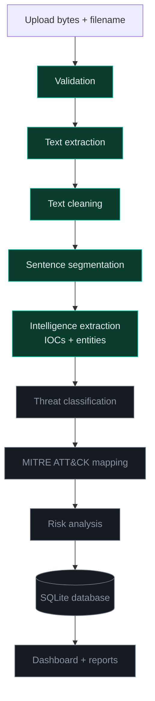
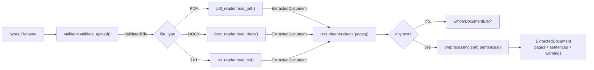

# CyberSleuth Architecture

## Target pipeline

Each stage is an independent, separately tested module. Stages communicate only
through the data contracts in `src/ingestion/models.py`.



Green stages are implemented (Phases 1–2). Grey stages come in later phases.

## Phase 2: intelligence extraction

`src/intelligence/analyzer.py::Analyzer.analyze()` runs ingestion, then
`IOCExtractor.extract()`, then `EntityExtractor.extract()`, and returns an
`AnalysisResult`. Its derived views (`evidence`, `vulnerabilities`) come from
`evidence_manager.py`. The `Analyzer` holds the spaCy model and phrase matchers, so it
is created once (the app caches it with `st.cache_resource`). If the model is missing,
entity recognition falls back to the rules only.

| Module | Responsibility |
|---|---|
| `src/nlp/ioc_models.py`, `ioc_extractor.py` | IOC types and flags; defang-aware matching, validation, de-duplication, evidence |
| `src/nlp/entity_models.py`, `entity_kb.py`, `entity_extractor.py` | Entity types and sources; KB loading and validation; KB + pattern + spaCy recognition |
| `src/intelligence/evidence_manager.py` | Findings per sentence; merging CVE IDs with named vulnerabilities |
| `src/visualization/tables.py` | Plain table builders; validated ATT&CK/NVD links |
| `src/evaluation/` | Metrics and the gold-file evaluation runner |

## Phase 1: ingestion



`src/ingestion/pipeline.py::ingest()` orchestrates these steps. It reports each
`Stage` to an optional callback, so callers can show progress without the
pipeline depending on any UI framework.

### Module responsibilities

| Module | Responsibility | Does not do |
|---|---|---|
| `config/settings.py` | Read-only limits and paths; `CYBERSLEUTH_*` environment overrides | Business logic |
| `src/utils/exceptions.py` | Error types (`IngestionError` and its subclasses) | — |
| `src/ingestion/models.py` | Data contracts: `ValidatedFile`, `ExtractedDocument`, `PageText`, `Sentence` | I/O |
| `src/ingestion/validator.py` | Size limits, detection by magic bytes, extension/content agreement, zip-bomb guard | Full parsing |
| `src/ingestion/pdf_reader.py` | Per-page text, metadata, encrypted/scanned/repaired detection | OCR |
| `src/ingestion/docx_reader.py` | Paragraphs and tables in document order, core properties | Headers, footers, text boxes |
| `src/ingestion/txt_reader.py` | Encoding detection | — |
| `src/ingestion/text_cleaner.py` | Unicode and whitespace normalisation that leaves IOCs unchanged | Changing indicators |
| `src/nlp/preprocessing.py` | Sentence segmentation that keeps exact source positions | Linguistic analysis |
| `src/ingestion/pipeline.py` | Runs the stages in order and reports progress | Stage logic itself |
| `app.py` | Streamlit presentation | Processing logic |

### Data contract

```text
ExtractedDocument
├── filename, file_type, sha256, size_bytes     identity (sha256 → later DB dedup)
├── pages: list[PageText(page_number, text)]    cleaned text, 1-based pages
├── sentences: list[Sentence(text, page_number, char_start, char_end)]
├── metadata: dict[str, str]                    author-supplied, untrusted, length-limited
├── warnings: list[str]                         shown to the analyst
└── needs_ocr: bool
```

Invariant: `pages[n].text[s.char_start:s.char_end] == s.text` for every sentence.
Later phases attach evidence (IOCs, entities, ATT&CK matches) to these positions,
so every finding can be traced to an exact location in the source document.

## Security model

Uploaded documents are treated as hostile input.

| Threat | Control |
|---|---|
| Executable or other content disguised as a document | Detection from magic bytes, plus a check that the extension matches the content |
| Oversized input / resource exhaustion | File size limit (20 MB), PDF page limit (500), Streamlit's own upload limit (25 MB) |
| DOCX decompression bomb | Total unpacked size (100 MB) and entry count (2,000) checked from the ZIP index before parsing |
| XML external entities (XXE) in DOCX | python-docx parses with `resolve_entities=False` |
| Path traversal in filenames | Filenames reduced to the base name with control characters removed; uploads are never written to disk |
| Markdown/link injection in the UI | Document text shown only in plain-text widgets; filenames, warnings and errors escaped before Markdown rendering |
| Accidental contact with attacker infrastructure | Nothing ever resolves or fetches extracted URLs or IPs |
| Information leakage | Unexpected exceptions are logged; users see a generic message |

## Extension points

* **Sentence splitting**: any object with `split(page) -> list[Sentence]` satisfies
  the `SentenceSplitter` protocol and can be passed to `ingest(..., splitter=...)`.
  A spaCy-based splitter can be swapped in during Phase 2 and compared against the
  rule-based one.
* **New formats**: add a reader that returns `ExtractedDocument`, a `FileType`
  member, a magic-byte rule in the validator, and a `case` in `pipeline._read`.
